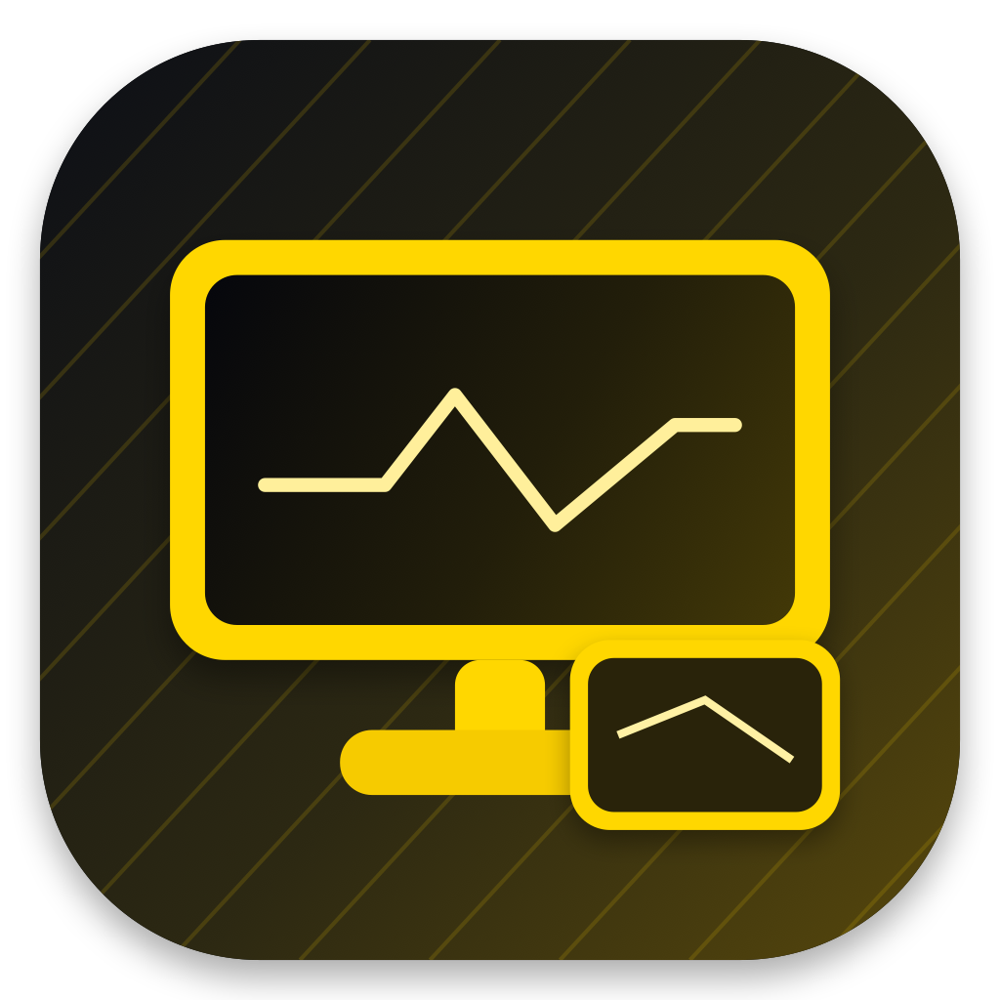
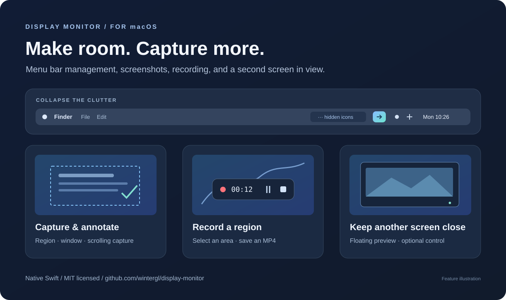

<p align="center"></p>
<h1 align="center">Display Monitor</h1>
<p align="center"><strong>菜单栏收起来，截图录屏随手用。</strong></p>
<p align="center">一款原生 macOS 小工具：菜单栏收起与排序、截图标注、滚动长截图、区域录屏、扩展屏悬浮预览。</p>
<p align="center"><a href="https://github.com/wintergl/display-monitor/releases/latest">下载 Apple Silicon 版本</a> · <a href="README.md">English</a> · <a href="docs/BUILDING.md">从源码构建</a></p>


<sub>这是功能示意图，并非软件实拍截图。</sub>

## 把常用操作放到手边

菜单栏图标越来越多，真正经常用的只有几个。Display Monitor 可以把分界左侧的图标收起来，需要时再展开；截图和录屏也放在同一个入口，减少来回切换工具。

| 功能 | 能做什么 |
| --- | --- |
| **菜单栏收起** | 收起分界左侧的图标，点击临时展开；可设置自动重新收起，操作菜单时暂缓。 |
| **菜单栏排序** | 先调整草稿，点击“应用排序”后才移动真实图标，把常用项留在常显区。 |
| **截图与标注** | 区域、窗口、全屏、定时、重复上次区域；浮动结果支持复制、保存、编辑和贴图。 |
| **滚动长截图** | 跟随鼠标滚动拼接长图，提供手动控制和接缝检查。 |
| **区域录屏** | 框选区域，录制为 MP4，结束后可播放和管理文件；当前不录音。 |
| **扩展屏预览** | 在当前屏幕用悬浮窗查看另一块屏幕，调节大小、帧率，也可按住修饰键进行鼠标直控。 |

**菜单栏收起、排序要求 macOS 27+，系统接口可用，并从 `/Applications` 启动。** 应用最低部署目标为 macOS 13，不同系统的采集能力不同。现成安装包为 Apple Silicon 版本，界面目前以中文为主。详见[兼容性说明](docs/COMPATIBILITY.md)。

## 安装和使用

1. 从 [Releases](https://github.com/wintergl/display-monitor/releases/latest) 下载 DMG。
2. 将 **Display Monitor.app** 拖到“应用程序”，然后打开。
3. 通过菜单栏图标的上下文菜单进入工具和设置。
4. 截图、录屏、预览需要“屏幕录制”权限；菜单栏操作和鼠标直控按需申请“辅助功能”权限。
5. 在菜单栏设置中核对收起区、常显区，再启用长期收起。

现成安装包已经 Developer ID 签名和公证。源码自行构建支持临时签名，不需要使用作者的证书。初次公开版本的安装包与源码打包调整分别在 Release 中说明。

| 快捷键 | 操作 |
| --- | --- |
| `⌥ A` | 框选区域，在采集工具中选择截图、长截图或录屏 |
| `⌥ F1` | 开关扩展屏预览 |
| `⌥ ⌘ P` | 暂停/继续预览 |
| `⌥ ⌘ →` / `⌥ ⌘ ←` | 鼠标移到目标屏/主屏 |

快捷键可以在设置里修改。

## 源码构建

```sh
git clone https://github.com/wintergl/display-monitor.git
cd display-monitor
./script/build_and_run.sh --release-build-only
# 生成 dist/Display Monitor.app
swift test
```

建议使用 Apple Silicon Mac、Xcode 26+ 与 macOS 26 或更新 SDK。首次公开源码使用 Swift 6.4 检查。构建脚本不会覆盖已经安装的应用，也不会强制退出运行中的应用。详见[构建说明](docs/BUILDING.md)和[代码结构](docs/ARCHITECTURE.md)。

## 使用边界

- 菜单栏隐藏使用运行时解析的 macOS 私有框架，系统更新后可能变化；这部分实现不适合直接用于 App Store 上架。
- 点击系统时钟可能临时展开隐藏图标。
- 受 DRM 或系统保护的内容可能黑屏，镜像显示器不能作为独立画面监看。
- Monitor 与录屏并发有保守的能力检查，不可用时先关闭 Monitor 再录制。
- GIF 导出仍是默认关闭的实验功能。
- 当前没有分析 SDK、账号登录或云端上传客户端。截图、录屏和设置保存在本机；复制和导出由你主动触发。[隐私说明](docs/PRIVACY.md)

## 欢迎一起完善

欢迎提交问题复现、系统兼容性反馈和英文界面翻译。分享截图、日志前请先去掉个人信息。[贡献指南](CONTRIBUTING.md)

项目使用 [MIT 许可证](LICENSE)，可以使用、修改和集成，分发时保留版权及许可声明。如果你基于它做了工具、写了文章或用了其中的实现，欢迎链接回 **[wintergl/display-monitor](https://github.com/wintergl/display-monitor)**，让更多人找到原项目。仓库也提供了 [CITATION.cff](CITATION.cff)，可以使用 GitHub 的“Cite this repository”引用入口。
